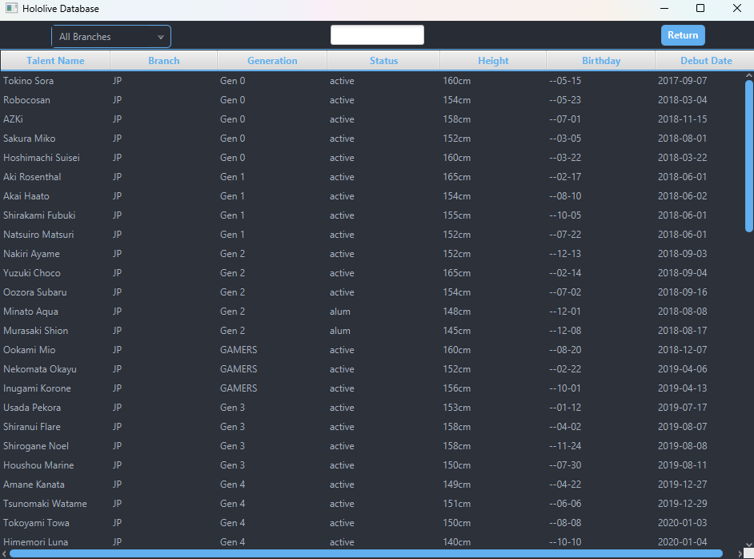
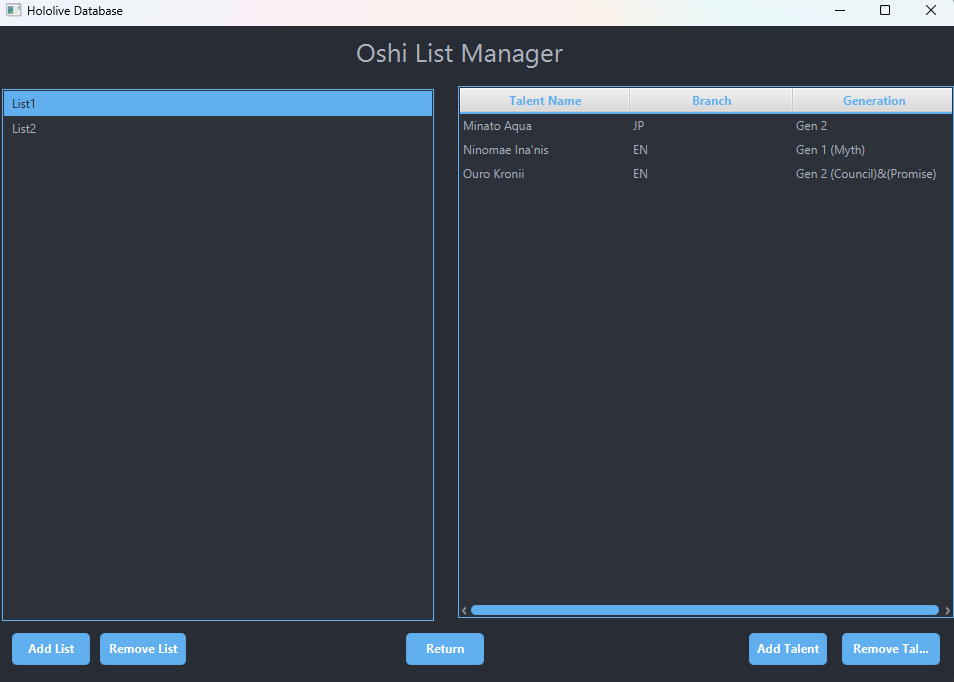
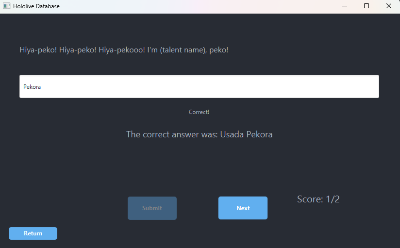

#  JavaFX Hololive Character Database
JavaFX desktop application for browsing, searching, and managing Hololive talent data.

## Features
- Hololive character database tracking of all talents with extensive detail. 
- Supports three different languages, English, Japanese, and the talent's Native language.
- Equipped with a page to view all talents, with searching and filtering capabilities. 
- Supports list creation, with no limit on number of talents per list.
- Ability to create and save lists in any of the three languages with individual saving capability.
- Support for both Imperial and Metric measurements.
- Statistics to give a detailed breakdown of talent information.
- Shows a talent's debut anniversary and birthday if it is today.
- All-inclusive quiz game with support of 5, 10, and 15 rounds.

## Screenshots

### Talent Database

### Custom Lists

### Quiz Game

## Used Technology
- Java 21
- JavaFX and FXML
- Maven
- Java Collections Framework
- Object-Oriented Programming

## Requirements
- Java Development Kit (JDK) 21

## How to Run
- Download or clone repository.
- Open the project's root directory in a Java IDE.
-  Run the application using the Maven Wrapper.

Windows:
.\mvnw.cmd clean javafx:run

macOS/Linux:
./mvnw clean javafx:run

## Structure 
- Main.java/HelloApplication.java - Entry point of code and JavaFX
- Library.java - Manages data, lists, and file persistence. 
- SceneManager.java - Handles navigation between different screens.
- Model Classes(Talent, Branch, Generation, Oshilist) - Handles talent information and collections.
- Controller Classes (AllTalentsController, QuizGameController, etc) - Handles functionality and user interaction with GUI.

## About
This is my largest project I have developed to this point, with an emphasis on taking my general Java knowledge using OOP concepts and creating a fleshed out desktop application using JavaFX and Maven.

This is an unofficial fan-made project and is not affiliated with COVER Corporation.
